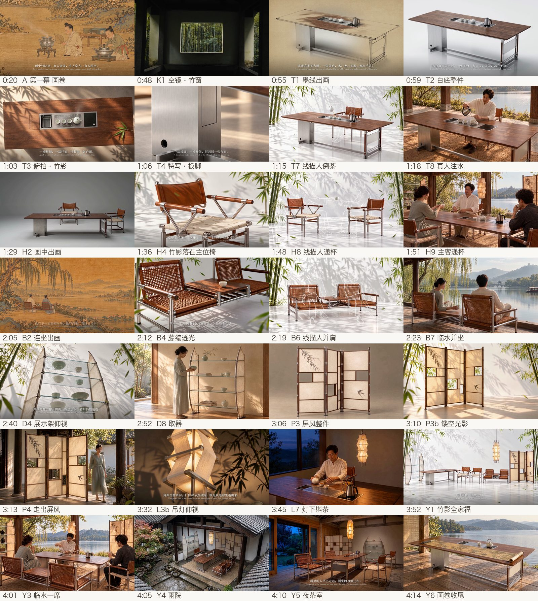

# product-film

用 AI 给**家具或产品**做 1–3 分钟介绍短片的技能，Claude Code 和 Codex 都能用，macOS 和 Windows 都能用。

从方案、完整脚本、关键帧、视频生成、旁白、配乐一直做到粗剪。每一步先给你看，你点头才往下做；花钱之前一定先问。

> 这套流程来自作者「节序」茶家具系列视频的实际制作，规则大多是被一张张否掉的图、一条条重做的视频换来的。

## 教程视频（2 分 39 秒）

https://github.com/user-attachments/assets/0f44856e-804b-425f-b09a-72628893123d

（播放不了时打开 [docs/tutorial.mp4](docs/tutorial.mp4)。）视频内容：分工说明、AI 做不了的三件事（插件文件访问、网页登录、RunningHub 密钥）、交素材与审画面。旁白为本机 Qwen3-TTS 合成，界面为示意重绘，RunningHub 页面以官网实际为准。
视频中的家具、关键帧与画卷外扩画面由作者 **yumi** 原创设计 / 制作，版权归作者所有。

## 第一次怎么开始

装好技能后，把下面这段话发给 Claude Code 或 Codex（方括号里换成你的内容）：

```text
用 product-film 技能，帮我给[产品名称，例如：一套七件的茶家具]做一个[1–3]分钟的介绍视频。
素材在[文件夹路径]：有每件产品的白底渲染图、爆炸图、细节图[，以及我自己的场景图 / 设计报告 PPT]。
风格参考：[例如：安静的东方纪录片 / 极简产品广告 / 附参考链接]。
旁白：[我自己录 / 用本机 Qwen3-TTS / 不要旁白]，声音偏好[女声播音 / 低沉男声]。
预算：RunningHub 余额约[数字]币。
请先自己检查并安装环境，只告诉我需要我亲手做的事；之后每一步先给我看，我点头再往下，花 RH 币之前先问我。
```

---

## 它能做什么

- **写方案和完整脚本**：每个镜头写到起始画面、内容、时长、怎么切到下一镜、旁白和字幕。
- **出关键帧**：在你已登录的 ChatGPT 网页一张张生成；再用 Gemini 网页洗成约 2752×1536 的高清图。
- **做视频**：用 RunningHub 上的 MiniMax H3 工作流，每条 10 秒，扣 RH 币。
- **配旁白**：用你提供的录音，或用本机 Qwen3-TTS 声音克隆（全片同一个声音）。视频模型只生成环境声，旁白另轨后期合成。
- **配乐和粗剪**：按剪辑点合成古琴风配乐，一份 JSON 配置直接出粗剪（字幕、片名、朱印都在里面）。
- **三种片子结构**：分幕写实、一镜到底、画卷（走进古画，产品逐件出画，最后出画入真）。
- **换工具接着做**：额度用完、换 Codex 或 CLI 时，用一份交接文件和执行者锁接手。

## 用起来是什么样

```
0 环境自检、收集渲染图/爆炸图/场景图 → 1 方案 → 2 完整脚本 → 3 风格样张
→ 4 关键帧 → 5 图文分镜给你审 → 6 洗高清 → 7 生成视频（新一幕先测一条）
→ 8 旁白 → 9 配乐、粗剪（瑕疵段剪掉）→ 10 逐幕审，迭代
```

第一次使用时，对它说「我想给我的家具做一个介绍视频」就行。**环境由 AI 自己检查、自己安装**，你只需要交素材、审画面。

### 只有三件事要你亲手做（AI 做不了）

1. **打开浏览器插件的文件访问**：Chrome 地址栏打开 `chrome://extensions` → 找到 browser-skill 点「详情」→ 打开「允许访问文件网址」。不开的话，AI 上传参考图会报 Not allowed。
2. **登录 ChatGPT 和 Gemini**：在同一个 Chrome 里自己登录；账号密码只由你输入。
3. **配 RunningHub 密钥**：登录 [runninghub.cn](https://www.runninghub.cn) → 顶部点 **API** → **获取密钥** → 左侧「密钥」选 **消费级-会员** → 复制 `default` 那条密钥（页面只显示前后几位，用旁边的复制按钮）→ 在终端运行下面这行（把引号里换成你的密钥），然后告诉 AI「配好了」，它会自己检查连接和余额。**不要把密钥发到聊天里。**

   **macOS**（终端）：

   ```bash
   echo 'export RUNNINGHUB_API_KEY="粘贴你的密钥"' >> ~/.zshrc
   ```

   **Windows**（PowerShell，运行后重开终端）：

   ```powershell
   setx RUNNINGHUB_API_KEY "粘贴你的密钥"
   ```

之后你要做的：交每件产品的渲染图、爆炸图、细节图和场景图；审方案、脚本、图文分镜和每一幕视频。花 RH 币之前它一定先问你。

## 几条核心规矩（技能会自动遵守）

| 规矩 | 为什么 |
|---|---|
| 产品造型以你的渲染图为准，每张图都对照检查结构 | AI 会悄悄改掉腿、横撑、扶手 |
| 不把渲染图抠出来贴进场景，整张生成 | 贴图的透视、比例、落地、摆放全错 |
| 爆炸图先完整停 1–2 秒，再合拢，最后看细节 | 一上来就合拢到一半，看不懂结构 |
| 每条视频只给一张起始帧，靠剪辑衔接，不做首尾帧硬接 | 硬接的接缝总是跳 |
| 写实画面用「去油」写法（下午侧光、淡天空、胶片颗粒） | 默认 AI 图又饱和又亮，像广告 |
| 写实帧生成视频前先洗高清 | 网页出图只有约 1672 宽 |
| 视频只生成环境声，旁白另轨后期合成 | 视频模型会乱加人声 |
| 默认机器、每条 10 秒（约 130–165 币） | 15 秒默认机器会爆显存，Plus 机器很贵 |
| 用户给过「不用再审」的长期授权时，只在已审分镜内直接成批生成 | 省掉重复审核，又不越权 |
| 视频有瑕疵段先剪掉再用，不够用才重抽 | 省币 |
| 同一时间只让一个 agent 操作浏览器和 RunningHub | 会抢窗口、排队、拖慢电脑 |

完整规则见 [`SKILL.md`](SKILL.md) 和 [`references/pitfalls.md`](references/pitfalls.md)。

---

## 需要准备什么

| 必需 | 说明 |
|---|---|
| macOS 或 Windows 10/11 | 两边流程一样；脚本自动识别系统（安装命令、字体、密钥读取方式不同） |
| Python 3.9+ | `pip install -r requirements.txt`（numpy、scipy、Pillow）。系统自带的 python 没有这些库时，建一个 venv |
| ffmpeg、ImageMagick 7 | macOS：`brew install ffmpeg imagemagick`；Windows：`winget install Gyan.FFmpeg` 和 `winget install ImageMagick.ImageMagick`（AI 会自己装） |
| Chrome + browser-skill | `bsk` 命令行和 Chrome 扩展；扩展详情里打开「允许访问文件网址」；在 Chrome 里登录 ChatGPT 和 Gemini |
| RunningHub 会员 API key | macOS 写进 `~/.zshrc`；Windows 用 `setx RUNNINGHUB_API_KEY`。不要贴进聊天 |

| 可选 | 说明 |
|---|---|
| 本机 Qwen3-TTS / ASR（mlx-audio） | 用来配旁白和回听核对；没有的话提供你自己的录音（WAV/MP3/M4A/FLAC）和文稿 |
| Codex CLI | 没有浏览器控制时的备选生图方式 |
| 配套技能 | hd-image-workflow（分块高清重建）、human-first-article（旁白去 AI 腔） |

一键自检：

```bash
python3 ~/.claude/skills/product-film/scripts/doctor.py
```

逐项列出 OK / MISSING / WARN 和补救办法。详细安装和排错见 [`references/setup.md`](references/setup.md)。

## 安装

**Claude Code**
```bash
git clone https://github.com/yumi233/product-film ~/.claude/skills/product-film
```

**Codex**（同一份技能）
```bash
ln -s ~/.claude/skills/product-film ~/.codex/skills/product-film
```
只用 Codex 时，直接 clone 到 `~/.codex/skills/product-film`。Windows 上 `~` 是 `%USERPROFILE%`，不能软链接时直接各 clone 一份。

---

## 脚本一览（`scripts/`）

| 脚本 | 作用 |
|---|---|
| `doctor.py` | 环境自检：缺什么、怎么补 |
| `gpt_web.py` | 在已登录的 ChatGPT 网页生成关键帧；同一对话连续出图，满 8 张或出错才换新对话 |
| `gemini_wash.py` | 在 Gemini 网页把关键帧洗成高清，内容不变 |
| `keyframe.py` | 备选：用 Codex CLI 生成关键帧 |
| `scroll.py` | 画卷外扩与拼接 |
| `rh_run.py` | 调 RunningHub MiniMax H3 生成视频；默认建议 6 秒 3.0 MP，OOM 自动降档（`--mp-fallback`）；参考图最多 5 张；`--key-env` 开第二个账号并行；任务号落盘，会话断了用 `--fetch` 取回；`--plus` 用大显存机器（贵） |
| `contact.py` | 视频抽帧拼成总览，用来检查 |
| `compare.py` | 关键帧和每件产品渲染图并排拼图，逐件对照结构 |
| `qc.py` | 实测自检：逐帧抖动（`jitter`）、响度/低频/嘶声（`audio`）、参考图数量（`refs`） |
| `stable_window.py` | 1.0 倍速下给每条素材挑最稳的 3–5 秒 |
| `still_push.py` | 静图亚像素慢推（替代会一卡一卡的 zoompan） |
| `music_phrases.py` | 找配乐的乐句起点，章节对齐用 |
| `mix.py` | 成片混音：配乐、真实环境声床、动作音效，旁白处包络让位，线性调到 -18 LUFS |
| `vo.py` | 本机 Qwen3-TTS 配旁白（`VO_REF` 声音克隆），ASR 回听核对 |
| `voicestat.py` | 测每句旁白的音高，检查音色是否一致 |
| `audio_policy.py` | 视频只留环境声；核听后才保留原音轨；支持导入你的旁白录音 |
| `score.py` | 程序合成的占位配乐（由 cut.py 调用；正式片用可商用真乐器曲） |
| `cut.py` | 读一份 JSON 配置，出画面 + 旁白 + 字幕；非 24 帧素材自动帧混合，`smooth` 抹平模型抖动，加速时警告 |
| `handoff.py` | 交接：状态快照写进交接文件；执行者锁 `who` / `claim` / `release` |

## 参考文档（`references/`）

| 文档 | 内容 |
|---|---|
| [`setup.md`](references/setup.md) | 安装、Codex 用法、环境自检、配套技能 |
| [`web-image.md`](references/web-image.md) | ChatGPT / Gemini 网页出图和洗图：怎么用、页面上发生了什么、常见报错 |
| [`structures.md`](references/structures.md) | 三种片子结构，画卷结构的「入画 · 一器一出画 · 一席 · 出画入真」 |
| [`shot-script.md`](references/shot-script.md) | 完整脚本模板、图文分镜审核、剪辑手法、预算 |
| [`prompts.md`](references/prompts.md) | 视频提示词；去油写实（白天 L6）、夜景、雨景、工笔画中、爆炸图、加人物、局部修改 |
| [`audio.md`](references/audio.md) | 旁白怎么写、声音克隆、用户录音导入、配乐、字幕、片名 |
| [`runninghub.md`](references/runninghub.md) | H3 工作流节点、费用实测、失败与取回、Plus 机器 |
| [`handoff.md`](references/handoff.md) | 在 Claude 桌面端、Claude CLI、Codex 之间交接 |
| [`pitfalls.md`](references/pitfalls.md) | 踩过的坑（含第三轮：噪声、抖动、跳切、配乐的实测原因） |

## 换工具接着做（多 agent 交接）

项目里只维护一份交接文件；每到一个节点就刷新状态：

```bash
python3 ~/.claude/skills/product-film/scripts/handoff.py status <项目目录> --write <交接文件>
python3 ~/.claude/skills/product-film/scripts/handoff.py who   <项目目录>          # 现在谁在做
python3 ~/.claude/skills/product-film/scripts/handoff.py claim <项目目录> "Codex"  # 接手前占住
```

给接手的 agent 发一句话：

```text
接手<项目名>视频：先读 <交接文件>，用 handoff.py who/claim 占住执行者锁，检查正在跑的任务并接上，然后按里面的规则和顺序继续，每批结束汇报生成了什么、花了多少 RH 币，并更新交接文件。
```

详见 [`references/handoff.md`](references/handoff.md)。

## 费用参考（2026-10 实测，RunningHub）

| 设置 | 一条 | 用时 |
|---|---|---|
| 默认机器，2.07 MP，10 秒 | 约 130–145 币 | 约 11 分钟 |
| 默认机器，15 秒 | 爆显存失败（不扣费） | — |
| Plus 机器，15 秒 | 508 币 | 约 21 分钟 |

关键帧和洗图走网页，不花 RH 币。

---

## 示例效果

**真实案例（最新）**：[《节序》v16 成片的完整分镜、旁白、声音和自检数据](examples/jiexu-v16/README.md)（作者 yumi，4 分 22 秒，六件家具一器一段）。



早期版本：示例项目「节序 Nodes in Order」茶家具系列视频的制作过程（[`examples/nodes-tea-furniture/`](examples/nodes-tea-furniture/)）。

**第一幕用的长卷**：以仇英《竹院品古》为中段，向左右两侧外扩，拼成 9600×1350。


**第一幕粗剪抽帧**：引首题字，长卷一路向左展开，最后停在空亭。


**关键帧**：人物定妆，以及在作者设计的茶台、客位椅上进行的茶事。


## 版权说明
- **家具设计**：示例中的茶台、主位椅、客位椅等家具及其渲染图，均为作者 **yumi 原创设计**，版权归作者所有。未经许可，不得使用、复制或用于商业用途。`docs/showcase/` 中的图片与 `docs/tutorial.mp4` 教程视频中的画面均为作者原创并已标注。
- **古画**：仇英《竹院品古》属于公有领域。长卷的外扩部分和画中动态由 AI 生成，仅作示例。
- **人物**：示例中的人物均为 AI 生成，不对应真实的人。
- **代码与文档**（`scripts/`、`references/`、`SKILL.md`）可以自由使用。
