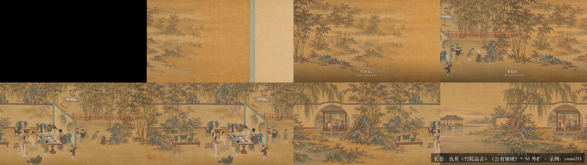
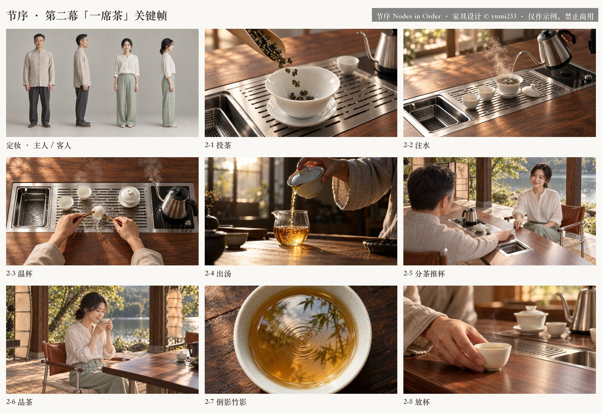

# product-film

一个 Claude 技能，用 AI 给**家具或产品**做 1–3 分钟的介绍短片。从创意、分镜、关键帧，到视频生成、旁白、配乐，一直做到粗剪。流程是一幕一审：每一步先给用户看，确认后再花钱生成。

- 入口：[`SKILL.md`](SKILL.md)
- 规则：[`references/`](references/)
  - 三种结构：分幕写实、一镜到底、画卷（出画入真）
  - 分镜模板
  - 提示词写法
  - 声音与字幕
  - RunningHub 接入
  - 踩坑清单
- 脚本：[`scripts/`](scripts/)

  | 脚本 | 作用 |
  |---|---|
  | `rh_run.py` | 调 RunningHub 上的 MiniMax H3 工作流生成视频 |
  | `keyframe.py` | 用 Codex 生成关键帧 |
  | `scroll.py` | 画卷外扩与拼接 |
  | `contact.py` | 把视频抽帧拼成总览，用来检查 |
  | `vo.py` | 用 Qwen3-TTS 生成旁白，并用 ASR 回听核对 |
  | `score.py` | 按剪辑点合成配乐 |
  | `cut.py` | 读一份 JSON 配置，直接出粗剪 |

- 示例：[`examples/nodes-tea-furniture/`](examples/nodes-tea-furniture/)

## 需要的环境
- macOS，Python 3.9+（需要 numpy、scipy、Pillow），以及 ffmpeg。
- [Codex CLI](https://github.com/openai/codex)：用来生成关键帧。
- RunningHub 会员 API key，写在环境变量 `RUNNINGHUB_API_KEY` 里。视频走工作流接口，扣 RH 币。
- 本地 Qwen3-TTS 和 Qwen3-ASR（通过 mlx-audio 运行）。用环境变量 `QWEN3_TTS_DIR` 指定所在文件夹。

## 安装
把整个目录放到 `~/.claude/skills/product-film/`。

## 示例效果
以下是示例项目「节序 Nodes in Order」茶家具系列视频的制作过程。

**第一幕用的长卷**：以仇英《竹院品古》为中段，向左右两侧外扩，拼成 9600×1350。

**第一幕粗剪抽帧**：引首题字，长卷一路向左展开，最后停在空亭。

**第二幕关键帧**：人物定妆，以及在作者设计的茶台、客位椅上进行的茶事。

## 版权说明
- **家具设计**：示例中的茶台、主位椅、客位椅等家具及其渲染图，均为作者 **yumi233 原创设计**，版权归作者所有。未经许可，不得使用、复制或用于商业用途。`docs/showcase/` 中的图片均已标注。
- **古画**：仇英《竹院品古》属于公有领域。长卷的外扩部分和画中动态由 AI 生成，仅作示例。
- **人物**：示例中的人物均为 AI 生成，不对应真实的人。
- **代码与文档**（`scripts/`、`references/`、`SKILL.md`）可以自由使用。
